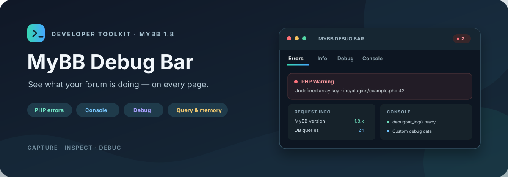

# MyBB Debug Bar for MyBB 1.8

<p align="center">
  
</p>

A floating debug panel for MyBB. It adds a small `>_` button to every page, front end and Admin CP, which opens a panel with captured PHP errors, console output, custom debug data, database query count, memory usage and system information.

- **Version:** 1.1.0
- **Codename:** `mybb_debugbar`
- **Compatibility:** MyBB 1.8.x (`18*`)
- **Author:** PARAD0X — [MyBB profile](https://community.mybb.com/user-134311.html)
- **License:** GPL-3.0
- **Dependencies:** PluginLibrary 13, bundled as `inc/plugins/pluginlibrary.php`

## Features

- Draggable `>_` icon with an error-count badge; position is persisted in `localStorage`.
- Four panel tabs: **Errors**, **Info**, **Debug**, and **Console**.
- Captures PHP errors with type, message, file, line, and backtrace.
- Info includes page URL, MyBB version, user and UID, usergroup, database query count, execution time, peak memory, and PHP version.
- Console collects PHP `debugbar_log()` output and intercepted JavaScript console calls.
- Debug tab accepts `debugbar_debug()` data across event, DOM, network, runtime, PHP, configuration, and performance slots.
- Optional logging of captured PHP errors to a database table.
- Admin CP settings page includes a PHP code box for ad-hoc debug calls.
- Runs on both the public forum and Admin CP using separate renderers.
- Optional JavaScript capture for events, AJAX/fetch, errors, timers, storage, and performance.

## Requirements

- MyBB 1.8.x
- PHP 7.0 or newer
- PluginLibrary 13
- MySQL or MariaDB (the installer uses MySQL-specific DDL)

## Installation

1. Copy the contents of this repository over the forum root.
2. In **Admin CP → Configuration → Plugins**, activate **MyBB Debug Bar**. Installation setup runs during activation.
3. Configure it under **Configuration → MyBB Debug Bar** or **Configuration → Settings → MyBB Debug Bar Settings**.
4. Visit a board or Admin CP page as a member of an allowed usergroup.

## Helper API

```php
debugbar_log($message, $label = 'log');
debugbar_debug($key, $data = null, $slot = 'custom');
```

`debugbar_log()` appends to the Console tab. `debugbar_debug()` appends structured data to the Debug tab. JavaScript helpers are `debugbarDebug(key, data, slot)`, `debugbarToggle()`, `debugbarOpen(tab)`, and `debugbarClose()`.

## Important security and privacy note

This plugin exposes diagnostic information such as paths and environment data. Restrict access to trusted usergroups. The custom PHP setting is evaluated on requests for allowed groups, and captured form/AJAX data may contain sensitive values when optional JavaScript capture is enabled. Review the settings and the documented limitations in the source before enabling these features on a public forum.

## License

GPL-3.0. See [LICENSE](LICENSE).
